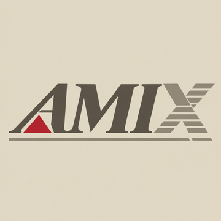

# amix-gate

The kernel side of AMIX on an A3000 with a Z3660: our drivers, the 68040/68060
port and the programs that run on the Z3660's second ARM core. Userland is in
[amix-userland](https://github.com/isoriano1968/amix-userland).

The names follow Solaris: the gate is the system, userland is what is built on it.
A package in amix-userland may need something built here: `x11/mesa-183` takes
`libGL` and `libzzgl` from `firmware/core1`, and its manifest says what else it
needs. How packages are made: [creating-a-package.md](https://github.com/isoriano1968/amix-userland/blob/main/doc/creating-a-package.md).

**No AMIX source goes in here.** The AMIX kernel and headers are Commodore's and
not ours to publish: only code we wrote, patches and notes. Nothing compiled
either. Bring your own AMIX installation.

## Layout

    usr/src/uts/amiga/io/<driver>/   kernel drivers
    usr/src/uts/amiga/port/          the 68040/68060 kernel port
    usr/src/firmware/core1/          programs for the Z3660's core 1, zzgl
    doc/                             how the tree works

The paths follow AMIX's own tree: a driver lands where it would in the kernel
source.

| Path | What |
| ---- | ---- |
| `io/paula` | Native Paula audio, `/dev/paula` |
| `io/random` | `/dev/random`, `/dev/urandom` |
| `io/hydra` | Hydra Systems AmigaNet Ethernet |
| `io/zz9000` | MNT ZZ9000 framebuffer and console |
| `io/z3660net` | Z3660 onboard Ethernet, by Jussi Alanärä |
| `io/z3660scsi` | Z3660 SD storage as SCSI, by Jussi Alanärä |
| `io/soft3d` | soft3D RTG 3D, with Jussi Alanärä; the current driver is `io/zz9000` |
| `port` | 68040/68060 port, by Antti Sokero and Jussi Alanärä |
| `firmware/core1` | Video and GL on core 1: zzgl, the zz3660 Gallium driver, Mesa 18.3 |

GCC 2.7.2.3, which builds the kernel and drivers, is `developer/gcc-27` in
amix-userland.

## Building

**[doc/building.md](doc/building.md)** covers the compilers, the kernel, drivers and
core 1.

## Licence

Each directory keeps its own licence and authors.
